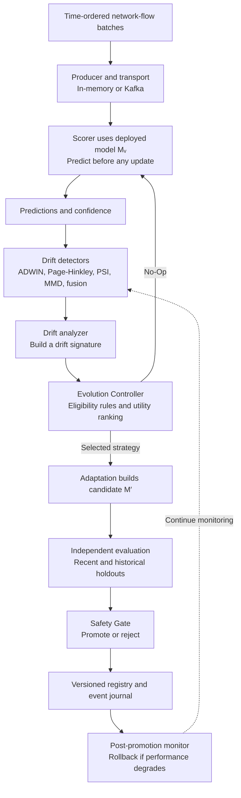

# EVO-X

EVO-X is an experimental framework for **continual intrusion detection under concept drift**. It processes network-flow data over time, watches for changes in traffic or model performance, and evaluates possible model updates before they can replace the active intrusion-detection model.

The project supports Random Forest and XGBoost classifiers, in-memory and Kafka streaming transports, multiple drift detectors, candidate adaptation strategies, and a versioned model lifecycle with promotion and rollback.

> **Research status:** CICIDS2017 real-flow data and quick real-source runs are available. Drift events used in the controlled experiments are injected into data pools; they are not naturally observed attack transitions. Full multi-seed real-data evaluation is still needed before drawing research conclusions. Synthetic runs validate the pipeline, not real-world detection performance.

## Architecture

The system has three main stages: **observe the stream**, **propose and evaluate an update**, and **manage the model lifecycle**.



**Important:** a detector alarm does not automatically update the model. The controller may choose No-Op. An update strategy creates a candidate model, which must pass independent evaluation and the Safety Gate before promotion. In Phase B, candidates remain in shadow mode. Phase C implements promotion, version history, monitoring, and rollback.

## How a run works

1. **Prepare data.** Load CICIDS2017 flow records, clean invalid values, remove identifier columns from model features, encode labels, and build a time-ordered stream.
2. **Train the initial IDS.** Fit the selected classifier on the reference training window. The reference validation window is kept separate.
3. **Replay batches.** A producer sends batches through the selected transport. The scorer predicts without using the true labels. The default stream batch size is 1,000 flows.
4. **Monitor for drift.** Feature-based detectors compare recent traffic with a reference; error-based detectors use labels when they become available. The default label delay is two batches.
5. **Decide whether to adapt.** The analyzer summarizes an alarm as a drift signature. The controller chooses No-Op or an eligible adaptation strategy.
6. **Evaluate and manage candidates.** Phase C evaluates candidates on independent data, applies safety rules, records model versions, and can roll back a promoted model if monitoring detects degradation.

## Project phases

| Phase | Purpose | Main implementation |
|---|---|---|
| **A — Streaming and drift lab** | Replay streams, create controlled drift scenarios, compare detectors, and summarize detected events. | `streaming/`, `drift/`, `evaluation/drift.py` |
| **B — Adaptation and controller** | Build candidate models and record controller decisions in shadow mode. | `adaptation/`, `evolution/controller.py`, `experiments/evolve.py` |
| **C — Safety and lifecycle** | Independently evaluate candidates, gate promotion, maintain versions, monitor deployed updates, roll back, and compare policies. | `evolution/safety.py`, `lifecycle/`, `experiments/compare.py` |

## Repository layout

```text
src/evox/
  data/            # loaders, preprocessing, adapters, streams, synthetic data
  models/          # Random Forest, XGBoost, update interface, model loading
  streaming/       # message codec, in-memory/Kafka transports, producer, scorer
  drift/           # detectors, drift signatures, controlled scenario generation
  adaptation/      # label policy, bounded memory, candidate strategies
  evolution/       # controller, proxy evaluation, Safety Gate
  lifecycle/       # versioned model registry, event journal, promotion, rollback
  evaluation/      # detection, streaming, candidate, and comparison metrics
  experiments/     # CLI workflows and experiment orchestration
  tools/           # data checks, reference sweeps, report generation
  cli.py           # unified command-line interface
  config.py        # paths and experiment defaults

tests/unit/         # unit tests grouped by package area
tests/integration/  # integration tests requiring external services
infra/docker/       # local Kafka configuration
docs/               # guides, architecture, research notes, reports, roadmap
data/raw/           # user-provided source CSVs (not included in the package)
data/processed/     # generated processed streams and drift scenarios
results/            # models, metrics, figures, reports, experiment runs
```

Reusable domain logic lives in its corresponding package. The `experiments/` package composes these pieces into repeatable workflows, while `cli.py` provides the supported command-line entry point.

## Installation

Python 3.11 or newer is required. From the repository root:

```powershell
uv venv .venv --python 3.12
uv pip install --python .venv/Scripts/python.exe -e ".[dev,kafka]"
```

With pip and an activated virtual environment, use `python -m pip install -e ".[dev,kafka]"`. Omit the `kafka` extra for in-memory experiments. Dependencies, package metadata, CLI registration, and pytest settings are defined in `pyproject.toml`.

## Running the project

Use the installed `evox` command after activating the virtual environment, or invoke it explicitly:

```powershell
.venv/Scripts/python.exe -m evox --help
.venv/Scripts/python.exe -m evox check-data
.venv/Scripts/python.exe -m evox build-stream
.venv/Scripts/python.exe -m evox replay run --synthetic --transport memory --check-equivalence
.venv/Scripts/python.exe -m evox evolve --synthetic --quick --output-dir results/runs/phase_b_synthetic_next
.venv/Scripts/python.exe -m evox lifecycle-demo --output-dir results/runs/phase_c_demo_next
```

`build-stream` uses CICIDS2017 CSVs in `data/raw/` when available and writes the processed stream under `data/processed/cicids2017_stream/` by default. Use `build-stream --synthetic` only for a synthetic pipeline check; it writes to the same default stream directory unless `--out-dir` is changed. Always use a fresh output directory for new experiment runs.

For a real-source Phase B run, first build the stream and use a matching Phase A detector configuration:

```powershell
.venv/Scripts/python.exe -m evox build-stream
.venv/Scripts/python.exe -m evox detect --stream-dir data/processed/cicids2017_stream
.venv/Scripts/python.exe -m evox evolve --stream-dir data/processed/cicids2017_stream --detector-config results/metrics/phase6_tuned_config.json --output-dir results/runs/phase_b_real_next
```

Run `evox COMMAND --help` to see a workflow's options. Real runs require CICIDS2017 CSVs, a processed stream, and matching detector/controller configurations; the real workflows do not silently substitute synthetic traffic.

Kafka is optional. To start a local broker:

```powershell
docker compose -f infra/docker/compose.yaml up -d
```

## Configuration and outputs

Defaults use this checkout's `data/` and `results/` directories. Set `EVOX_PROJECT_ROOT`, `EVOX_DATA_DIR`, `EVOX_RESULTS_DIR`, or `EVOX_KAFKA_BOOTSTRAP` in the shell or deployment environment to override them. `.env.example` documents these variables; it is not loaded automatically.

- Processed streams are saved under `data/processed/`.
- New experiment run folders are normally saved under `results/runs/`.
- Shared metrics and figures are saved under `results/metrics/` and `results/figures/`.
- Phase B run protocols identify the source tag, detector snapshot, selected controller, and experiment scope.

Quick runs are pipeline checks, not full research evaluations. Controlled drift injection over real CICIDS2017 flows still does not represent a naturally recorded drift event. Check each run's report and provenance before interpreting its numbers.

## Documentation

- [Phase A: streaming and drift laboratory](docs/guides/phase-a.md)
- [Phase B: adaptation and Evolution Controller](docs/guides/phase-b.md)
- [Phase C: safety, lifecycle, and comparative experiments](docs/guides/phase-c.md)
- [Detailed repository architecture](docs/architecture.md)
- [Layout and command migration](docs/migration.md)
- [Remaining project roadmap](docs/roadmap.md)
- [Controller design notes](docs/design/controller.md)
- [Report source drafts](docs/reports/)

## Verification

The recorded project verification reports **207 tests passed and one broker-dependent test skipped**. The wheel and source distribution build successfully. Synthetic checks verify pipeline behavior; full real-data multi-seed evaluation and live deployment remain outstanding.
